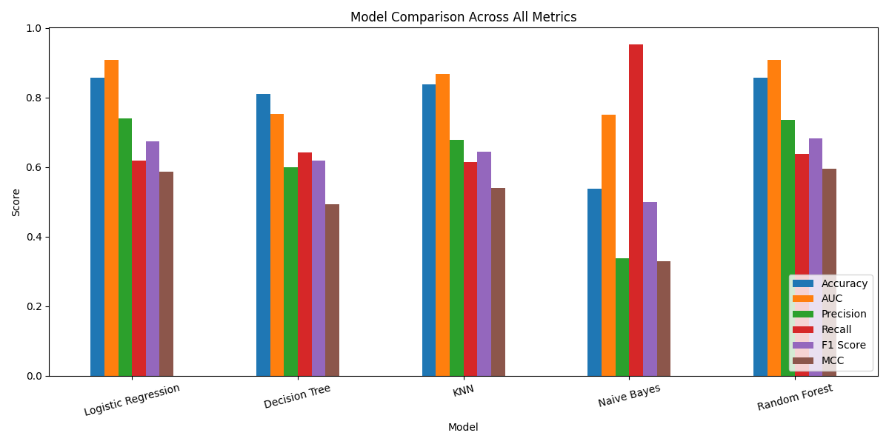

# Machine Learning Assignment 2 — Classification

## a. Problem Statement
This project builds and compares 5 machine learning classification models to predict whether an individual's annual income exceeds $50K, based on demographic and employment attributes. This is a binary classification problem.

## b. Dataset Description
- **Source:** UCI Machine Learning Repository — Adult (Census Income) Dataset
- **Link:** https://archive.ics.uci.edu/dataset/2/adult
- **Instances:** 32,561 (before cleaning)
- **Features:** 14 input features (6 numeric, 8 categorical)
- **Target variable:** `income` (binary: `<=50K` or `>50K`)
- **Class distribution:** ~75.9% `<=50K`, ~24.1% `>50K` — confirming class imbalance
- **Missing values:** Found in `workclass`, `occupation`, and `native_country` columns (marked as `?`), handled via mode imputation

## c. GitHub Repository Link
https://github.com/vinujp/2026ct05188ml-assignment2-classification/

## d. Models Used

### Preprocessing Summary
- Missing values imputed using mode (categorical columns)
- Duplicate rows removed
- Categorical features encoded using One-Hot Encoding
- Numeric features scaled using StandardScaler
- Train-test split: 80:20, stratified by target class, random_state=42
- Preprocessing (scaler/encoder) fit only on training data to avoid data leakage

### Comparison Table

| ML Model Name | Accuracy | AUC | Precision | Recall | F1 | MCC |
|---|---|---|---|---|---|---|
| Logistic Regression | 0.856 | 0.908 | 0.741 | 0.617 | 0.673 | 0.586 |
| Decision Tree | 0.810 | 0.753 | 0.599 | 0.641 | 0.619 | 0.494 |
| kNN | 0.837 | 0.868 | 0.677 | 0.614 | 0.644 | 0.539 |
| Naive Bayes | 0.538 | 0.749 | 0.337 | 0.953 | 0.498 | 0.329 |
| Random Forest (Ensemble) | 0.858 | 0.907 | 0.736 | 0.637 | 0.683 | 0.594 |

### Visualization

### Observations

| ML Model Name | Observation about model performance |
|---|---|
| Logistic Regression | Strong, well-balanced performance across all metrics (AUC 0.908, F1 0.673). As a linear model, it handled this dataset well, suggesting the relationship between features and income is largely linear/additive. |
| Decision Tree | Weakest AUC (0.753) and MCC (0.494) among all models. A single decision tree tends to overfit the training data without the variance-reduction benefit that ensembles like Random Forest provide. |
| kNN | Solid mid-range performance (Accuracy 0.837, AUC 0.868). Performance depends heavily on feature scaling (which was applied), since kNN uses distance between points. |
| Naive Bayes | Very high Recall (0.953) but very low Precision (0.337) and Accuracy (0.538). Naive Bayes assumes feature independence, which doesn't hold well here (e.g., education and occupation are correlated), causing it to over-predict the positive class. |
| Random Forest (Ensemble) | Best overall performer — highest Accuracy (0.858), F1 (0.683), and MCC (0.594). As an ensemble of many decision trees, it reduces the overfitting seen in the single Decision Tree while capturing non-linear patterns Logistic Regression might miss. |
| **Overall Winner** | **Random Forest** — best balance across Accuracy, F1, and MCC, which is the most reliable metric given the dataset's class imbalance. |

## How to Run This Project
1. Clone this repository
2. Install dependencies: `pip install -r requirements.txt`
3. Download the Adult dataset (`adult.data`) from the UCI link above and place it in the project folder
4. Open and run the notebook in `model/` in Jupyter or Colab, cell by cell, in order
